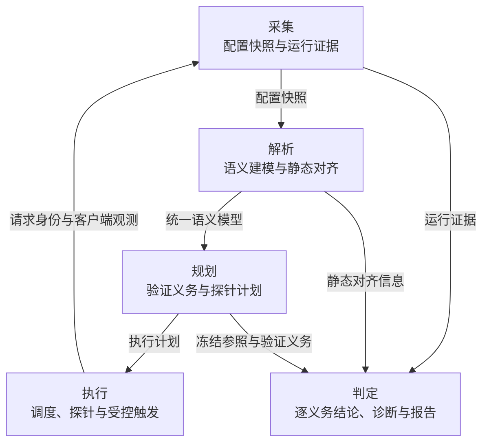
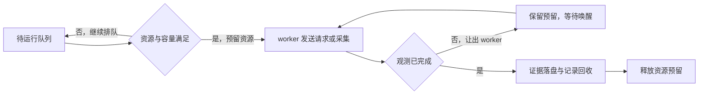

# ConfigPilot：面向服务网格的配置验证

ConfigPilot 面向服务网格的配置验证，将声明配置、已安装规则和运行证据关联起来，检查配置在各阶段是否按预期生效。方案包括分阶段验证、跨层统一语义模型、低开销验证规划，以及配置依赖分析与诊断。

原工程名 MeshScope 和底层包名继续保留。统一入口为 `python -m configpilot`。验证以完整义务集合为基础，保留独立执行基线，在触发条件、执行环境与证据要求兼容时复用验证工作；未知语义和缺失证据不会计为通过。

## 整体架构

系统按职责划分为**采集、解析、规划、执行、判定**五个核心模块。CLI、Web API、运行配置和统一编排作为公共支撑，负责调用各模块、保存阶段产物及提供查询接口。已有快照可以直接进入解析阶段，已有证据可以直接进入离线判定阶段。



采集模块在两个时点参与：执行前获取配置快照，执行过程中及执行后获取运行证据。因此，一次动态验证的数据流是“采集配置 → 解析 → 规划 → 执行 → 采集证据 → 判定”。运行证据直接交给判定模块，不需要重新走一遍配置解析。是否访问集群、是否发送流量、是否回放证据由调用参数决定；执行 `plan` 不会运行全部阶段。

## 模块职责

| 模块 | 负责什么 | 主要输入 | 主要输出 |
|---|---|---|---|
| 1. 采集 | 获取 Kubernetes/Istio 声明配置和 Envoy 配置快照；按请求 ID 批量读取执行回执，汇集客户端观测 | 集群访问配置、命名空间、采集方式、执行请求 ID | 控制面与数据面快照、实际目标、尝试序列、字段与时间信息 |
| 2. 解析 | 解析不同层次的配置，构建统一语义模型，保留资源、规则和字段来源，形成跨层对齐信息 | 配置快照 | 统一语义模型、对齐状态、冲突信息与依赖 |
| 3. 规划 | 将验证需求转为完整义务，生成触发请求、行为断言和证据要求，选择可复用的探针 | 统一语义模型、目标命名空间、受控后端契约 | 全部验证义务、候选探针、覆盖依据、执行计划 |
| 4. 执行 | 检查配置、共享状态和容量冲突，调度 worker 沿真实代理路径发送请求；通过受控后端提供失败、延迟或并发保持条件 | 冻结计划、代理入口、配置代次条件、并发预算 | 请求身份、客户端响应、上游行为记录及执行统计 |
| 5. 判定 | 解释静态对齐结果，检查运行证据质量并逐义务判断；关联异常来源，组织诊断与报告 | 模型与对齐信息、冻结计划、运行证据 | PASS、FAIL 或 INCONCLUSIVE，证据引用、依赖候选与验证报告 |

这五个模块是职责划分，不要求分别部署。通常编排、规划、调度和判定运行在验证客户端；受控后端运行在测试环境中；Envoy 是被验证的实际代理。后端的响应生成属于执行能力，回执查询和汇集属于采集能力。一个后端进程可以承载多个目标端口，使用请求 ID 区分触发状态和回执。

公共编排负责运行身份、参照冻结、阶段调用和产物持久化；CLI/Web 负责交互与查询。它们贯穿五个模块，不单独列为核心验证模块。诊断与报告是判定模块的结果解释能力。

静态差异保存在对齐产物及对应报告中，动态运行报告按验证义务组织结论。两类结果通过资源与策略来源关联，供查询和诊断使用。

统一语义模型以 PAOC 描述单策略属性，并保存资源、规则、字段来源及必要的顺序、引用和联合约束。规划与判定消费同一份模型：例如，前序路由可能遮蔽后序路由，重试可能受到总超时预算限制，这些信息参与请求构造和断言选择。

静态检查与动态验证分别回答两个问题：前者检查“配置是否被正确表示和安装”，后者检查“满足触发条件后是否产生预期行为”。动态义务来自声明参照，不仅从静态匹配成功的条目生成。对两份已经投影到统一表示的模型，还可显式使用 `compare` 进行有限有效行为比较；完整原生 Envoy 语义投影仍属于支持范围中的限制。

## 模块之间的数据约定

验证义务、探针和证据分别保存，使它们可以独立组织和复用。

| 数据对象 | 含义 | 在工作流中的作用 |
|---|---|---|
| 统一语义模型 | 声明策略、规则与资源，以及来源、语义属性和模型指纹 | 为静态比较、动态期望和依赖诊断提供共同参照 |
| 验证义务 | 一项需要回答的问题，包含触发条件、行为断言、证据需求和执行前提 | 保留验证范围；暂时不可执行或证据不足的义务仍进入报告 |
| 探针计划 | 实际请求、负载、执行前提，以及探针对义务的覆盖依据 | 决定发送哪些请求；一个探针可以支持多个兼容义务 |
| 执行证据 | 某次运行中实际发生的响应、上游尝试、目标和字段变化 | 按运行、探针、执行、请求和事件身份归因，支持逐义务判定 |
| 判定与诊断 | 每项义务的结论、证据引用、依赖来源和候选资源 | 支持问题解释、结果查询、离线回放与完整性复核 |

例如，一条路由同时要求“请求到达指定服务”和“添加指定请求 Header”。规划器先保留两项义务；若同一个请求能够触发两项行为，且回执能够分别证明目标和 Header，则可以复用一次探针执行。目标服务正确而 Header 错误时，两项义务仍分别输出 PASS 和 FAIL。对于重试与超时，则需要区分失败后恢复和慢请求总预算等触发条件，并保留各自所需的尝试与时间证据。

## 整体工作流

开始前设置命名空间、快照路径和观测地址。使用受控执行时，还需准备目标 Service、实际代理路径、策略配置、受控后端和代次响应头。

1. **采集：获取配置快照。** 显式访问集群，获取声明配置及工作负载、网关的 Envoy 快照；已有快照时可直接复用。
2. **解析：构建模型与对齐信息。** parser 提取语义属性、来源和依赖，输出 `aligned_semantic.json`，其中包含静态对齐信息和 `relational_model`。编排层校验模型身份并保存 `reference_model.json`，固定本次验证期望。
3. **规划：安排验证工作。** 生成完整验证义务，分析依赖，构造请求、触发方式和证据要求。在兼容条件下复用探针，将选择结果写入 `probe_plan.json`；未规划义务仍保留。
4. **执行：调度探针并触发采集。** 满足配置、状态和容量条件后分配 worker，生成唯一请求 ID，通过代理发送请求。受控后端提供相应触发行为，采集模块持续汇集客户端观测和上游尝试回执；完成观测先落盘，再回收后端记录。
5. **判定：输出结论与诊断。** 检查触发和证据条件，对全部义务分别输出通过、失败或未判定，关联涉及的配置和服务，生成诊断与报告。保存的计划和证据可用于离线回放，`check` 用于复核报告。

一次验证会先保存模型、计划与全部义务，再进入执行阶段。若后续执行中断，编排层从已落盘的证据日志中恢复完成部分，其余义务保持未判定，并在报告中记录执行错误。

### 不同运行模式如何经过工作流

| 入口 | 经过的主要阶段 | 适用场景 |
|---|---|---|
| `collect` | 配置采集 | 刷新本地控制面和数据面快照 |
| `static` | 解析、建模与静态检查 | 从快照生成语义产物，检查已安装规则 |
| `plan` | 固定参照、义务生成、覆盖规划、规划报告 | 检查验证范围、触发方式和复用安排 |
| `dynamic --execute` | 规划或读取冻结计划、调度、请求、采集、判定、诊断 | 在已准备的代理路径和受控环境中执行验证 |
| `evaluate` | 读取冻结计划与已保存证据、判定、诊断 | 离线复现结论，无需重新发送流量 |
| `check` | 身份校验、证据重判、报告一致性复核 | 检查保存的模型、计划和结论是否一致 |
| `run` / `e2e` | 通过参数组合采集、静态解析和验证工作流 | 使用统一入口串联阶段；`--execute` 显式启用流量 |

CLI 和 Web 的验证 API 调用同一个 `run_validation()` 工作流，使用相同的计划与判定器。仅生成计划时，运行状态为 `PLANNED`，不代表动态验证已经通过。具体命令见后面的安装、执行和回放示例。

## 任务调度与观测

### 任务何时占用 worker



尚未获得资源的任务留在待运行队列中，不占 worker。任务进入显式观测等待时，执行线程可以处理其他独立任务；该任务涉及的配置、共享状态和请求容量预留继续保持。到达唤醒时间后，再由可用 worker 继续采集。当前调度器使用单调时间唤醒，HTTP 请求与采集调用自身仍是同步 I/O。

| 约束 | 调度方式 | 示例 |
|---|---|---|
| 配置资源 | 只读访问可以共享；写入与相应读写互斥 | 在契约允许时，同一 VS 的两个只读验证任务可并发 |
| 共享运行状态 | 同一实际状态域需要独占；不同名称不自动表示隔离 | 对同一 Envoy 连接池进行突发验证时，保留池状态预留 |
| 证据归因 | 每个请求及上游尝试必须能对应到探针和运行 | 通过请求 ID 批量读取回执，避免混入其他用例的观测 |
| 请求容量 | 将任务并发需求与配置、状态预留一起检查 | 多个任务的请求预留总量受 `--capacity` 限制 |

`--workers` 控制流量执行线程数；`--compute-workers` 控制指定计算后端的并行度；探针内部的请求并发度由计划负载决定；`--capacity` 控制总请求预留预算。它们分别影响执行调度、模型计算和测试负载。

### 测试流量与证据采集路径


测试请求经过实际 Envoy；回执查询使用受控后端的采集接口。这两个通道分别承担“触发被测行为”和“读取执行证据”。例如，重试验证由后端按请求 ID 返回预设失败序列，重试动作由 Envoy 执行，后端记录每次上游尝试。执行器据此检查重试次数、最终响应和时间预算。

多个任务的回执可以合并查询，但判定仍按义务独立进行。采集快照需要满足完成时间和完整性要求；共享连接池等状态也不能仅因回执可区分就解除互斥。

## 项目结构与代码入口

```text
configpilot/
  cli.py / relational_cli.py      CLI 分发与验证参数
  workflow.py                    冻结、规划、执行、回放和报告编排
  configuration_fence.py         可选的配置版本前后检查
  diagnostics.py                 配置、策略与证据关联诊断
  capabilities.py                功能支持范围清单
istio_config_parser/
  istio_monitor/                 控制面、数据面与入口快照采集
  main_parser.py                 解析、静态对齐和语义产物生成
  models/                        统一语义表示、公共 HTTP 语义与有限比较
  parsers/                       各类配置解析
istio_Dynamic_Test/
  internal/planning/             验证义务、候选探针、覆盖与计算接口
  internal/pipeline/scheduling/  资源预留、待运行队列与观测等待
  internal/traffic/              请求执行、受控后端、回执与运行租约
  configs/relational_examples/   可复用的配置与后端契约示例
  tests/                         模型、规划、执行、判定及调度回归
consistency_checker/
  config.py                      本地配置、环境变量与运行开关
  web/relational.py              统一验证工作流的 Web API
  web/server.py                  Web 服务、报告查询与兼容接口
  storage/                       SQLite 报告持久化与兼容视图
accelerators/dependency_closure/ 可选 Go 依赖闭包内核
docs/                            架构、方法定义与模块使用说明
```

规划与判定的部分函数共用 `internal/planning/` 中的实现：`relational.py` 和 `behavior_profiles.py` 既生成计划，也提供逐义务判定函数。Web 展示层读取报告，不重新定义判定规则。统一验证运行的模型、计划、证据和结果保存在文件产物中，SQLite 用于既有报告与查询兼容视图。

四项方法的联系和形式化定义见 [形式化说明](docs/ConfigPilot_关系模型与低开销验证规划_形式化说明.md)。详细实现与边界见 [架构说明](docs/ARCHITECTURE.md) 和 [实现核对表](docs/IMPLEMENTATION_STATUS.md)。

## 当前支持范围

- **模型：** 策略、规则和资源身份；有序选择、附着、引用、共享预算、潜在截断及待解析继承关系。未解释字段显式保留。
- **通用 HTTP：** 路由目标、普通请求/响应 Header 操作、字面量 URI 改写及有限顺序交互。
- **受控契约：** 分流批次、有限参数范围的重试恢复/总预算、固定小容量连接池溢出。
- **执行：** 同一 VS 内满足闭合契约的独立任务可并发；实际连接池状态仍互斥。全局请求预留预算限制总负载，等待时让出线程并保留必要预留。
- **采集：** 一个共享收集器批量查询请求 ID，保证快照不早于对应客户端完成时间。完成证据先逐探针落盘，再释放后端记录。
- **诊断：** 关联资源、策略、义务、探针和证据；提供依赖距离候选和潜在服务影响，不将图可达性当作因果证明。
- **有限静态比较：** 对已投影的两侧关系模型，从两侧生成见证，检查部分顺序差异、缺失和额外有效路由；不声称全域等价。

完整 Envoy 关系投影、任意继承/优先级、实例摘除验证、通用原生遥测归因及自动容量发现仍有限制。运行 `python -m configpilot capabilities` 查看机器可读清单。模型之外的策略保持未规划或未判定。

## 安装与最小运行

使用 Python **3.11+**。只有访问集群的采集/静态阶段需要对应快照或集群工具；规划和证据回放可完全离线运行。Go 是可选组件。

```bash
pip install -r requirements.txt
cp configpilot.example.json configpilot.json
python -m configpilot --help
python -m configpilot capabilities
```

复制配置示例后，在本地填写集群与观测地址；也可使用 `SSH_HOST`、`K8S_HOST` 等环境变量。密码和 Token 使用环境变量或运行时输入，避免写入可发布文件。PowerShell 可用 `Copy-Item configpilot.example.json configpilot.json` 完成复制。

首先采集并使用 parser 生成参照产物；已有快照时可直接跳过采集：

```bash
python -m configpilot collect --namespace YOUR_NAMESPACE
python -m configpilot static --namespace YOUR_NAMESPACE --export
```

只生成验证计划，不发送请求、不修改集群：

```bash
python -m configpilot plan \
  --aligned results/consistency/aligned_semantic.json \
  --output-dir results/relational/plan-demo
```

需要先刷新本地静态产物时，使用 `run --parse-static`；只有显式指定 `--collect` 才通过现有采集器访问集群。`run` 没有 `--execute` 时不会自动发流量。

```bash
python -m configpilot run --parse-static --namespace YOUR_NAMESPACE \
  --output-dir results/relational/refreshed-plan
```

目录必须不存在或为空，以防不同运行的证据混用。

## 受控执行

受控后端是配合客户端的响应与记录服务，不替代实际代理。网关策略路径为“客户端 → 网关 Envoy → 受控后端”；网格内部路径须通过适用的工作负载代理。直接绕过全部代理访问后端不能验证网格策略。

后端示例：

```bash
python -m configpilot controlled-backend -- \
  --namespace controlled-lab \
  --backend retry-backend:19401 --backend pool-backend:19402 \
  --bind 0.0.0.0 --control-port 19490 \
  --max-records 20000 --retention-seconds 300
```

一个进程可提供多个端口；不同测试请求使用独立 ID 和触发参数。该命令不安装 Service、Endpoint、VS 或 DR，必须提前准备专用目标和实际策略。回执接口只监听回环地址，执行器需在同一主机或通过显式隧道访问。

```bash
python -m configpilot dynamic \
  --aligned aligned_semantic.json --profiles profiles.json \
  --execute --endpoint-url http://PROXY_HOST:PORT \
  --backend-control-url http://127.0.0.1:19490/ \
  --activation-headers activation-headers.json \
  --workers 4 --capacity 32 \
  --output-dir results/relational/execution-demo
```

通用无状态 HTTP 可省略 `--profiles`；重试、分流和连接池使用显式契约。`--endpoint-url` 是实际代理入口 origin，不含业务路径，路径来自冻结探针计划。后端参数、契约范围及代次头示例见 [受控执行说明](docs/CONTROLLED_STIMULUS_VALIDATION.md)。

执行阶段不写 VS/DR；环境准备和切换批次的配置操作不属于“零配置写入”。同主机同时运行的协作进程会对共同入口/后端采用运行级排他保护，避免两个独立调度器绕过状态预算；这不提供跨主机分布式锁，也不阻止集群外部变更。

需要集群版本保护时，追加 `--verify-config-versions`：通过只读 kubectl 比较执行前后的 UID、resourceVersion 和 spec，变化时将受影响运行保留为未判定。未开启时需由调用者冻结部署；固定的响应代次头本身不能证明不存在未标记更新。

## 离线回放与完整性检查

使用保存的模型和计划，不按当前集群状态重建期望：

```bash
python -m configpilot evaluate \
  --plan results/relational/execution-demo/probe_plan.json \
  --evidence results/relational/execution-demo/captured_evidence.json \
  --output-dir results/relational/replay-demo

python -m configpilot check --run-dir results/relational/replay-demo
```

`check` 重新判定并核对保存结果。CLI 退出码：`0` 表示操作完成或验证通过（规划、有限比较不代表全域正确），`1` 表示基础设施/输入错误，`2` 表示发现失败义务，`3` 表示仍有未判定义务。`PLANNED` 表示完成规划，不能当作动态验证通过。

统一验证运行保存以下产物；证据文件与逐探针日志按执行或回放模式产生：

| 产物 | 内容 |
|---|---|
| `reference_model.json`、`probe_plan.json` | 冻结参照与候选/覆盖/选中探针 |
| `validation_obligations.json`、`coverage_decisions.json` | 全部义务与覆盖依据 |
| `evidence_journal/`、`captured_evidence.json` | 逐探针持久化及完整/部分执行证据 |
| `obligation_results.json` | PASS / FAIL / INCONCLUSIVE、原因与证据引用 |
| `execution_metrics.json`、`run_report.json` | 请求、采集、负载、调度与覆盖完成度 |
| `dependency_graph.json`、`diagnostics.json` | 资源/策略/证据关联和异常候选 |

## 多核计算与 Go

流量 worker 和计算 worker 分开设置。索引化闭包默认串行计算；需要时使用 Python 两进程：

```bash
python -m configpilot plan --aligned aligned_semantic.json \
  --compute-backend process --compute-workers 2 \
  --output-dir results/relational/process-plan
```

构建可选 Go 内核后，通过 `--compute-backend go --go-binary PATH` 启用。Go 只负责闭包预计算，规划和证据断言继续由 Python 执行。实现与构建见 [Go 内核说明](accelerators/dependency_closure/README.md)。历史实验没有证明完整 Go 重写更好，索引化实现也需要单独测量，不能直接套用历史实验加速比。

## Web

```bash
python -m configpilot web --port 8080
```

验证 API 与 CLI 使用同一个工作流：

- `POST /api/validation/plan`：规划。
- `POST /api/validation/run`：显式受控执行，需要后端和代次条件。
- `POST /api/validation/evaluate`：离线证据判定。
- `GET /api/validation/capabilities`：支持清单。
- `GET /api/validation/runs`：验证报告列表。
- `GET /api/validation/runs/<run_id>/report|graph|diagnostics|plan|results`：读取产物。

生成、执行及流水线 API 默认调用统一工作流；指定 `engine: "legacy"` 时使用矩阵兼容路径。三层图页面与 SQLite 报告视图保留，证据依赖图目前通过 JSON API 和产物提供，尚未完成专门的前端编辑/展示流程。

## 仓库内容与本地文件

仓库包含实现源码、使用文档、配置示例和自动化回归测试。`archive/`、`output/`、`evaluation/`、`submission/`、`results/`、依赖缓存和临时文件不随源码发布。

本机运行配置 `configpilot.json`、集群快照和凭据由使用者在本地准备，并由 `.gitignore` 排除。矩阵兼容入口为 `legacy-dynamic`、`legacy-run` 和 `legacy-check`，须显式调用。

## 开发验证与文档

```bash
python -m unittest discover -s istio_Dynamic_Test/tests -v
```

设置 `CONFIGPILOT_TEST_GO_BINARY` 指向已编译程序可同时测试 Go 路径。测试涵盖闭包方向、覆盖保持、真实 HTTP 回执适配、共享采集新鲜度、容量预留、回收和 Web/CLI；测试代理不等于真实 Envoy，已有真实集群实验与回归测试需分别报告。

- [整体架构](docs/ARCHITECTURE.md)
- [实现核对表与剩余缺口](docs/IMPLEMENTATION_STATUS.md)
- [统一语义模型与验证规划形式化](docs/ConfigPilot_关系模型与低开销验证规划_形式化说明.md)
- [验证规划契约](docs/RELATIONAL_VALIDATION.md)
- [受控后端](docs/CONTROLLED_STIMULUS_VALIDATION.md)
- [并行与调度](docs/PARALLEL_VALIDATION.md)
