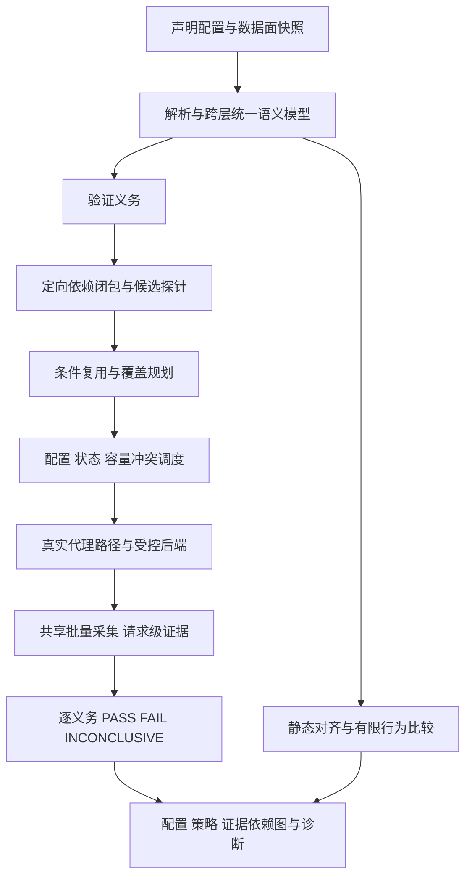

# ConfigPilot：面向服务网格的配置验证

ConfigPilot 面向服务网格的配置验证，将声明配置、已安装规则和运行证据关联起来，检查配置在各阶段是否按预期生效。方案包括分阶段验证、跨层统一语义模型、低开销验证规划，以及配置依赖分析与诊断。

原工程名 MeshScope 和底层包名继续保留。统一入口为 `python -m configpilot`。验证以完整义务集合为基础，保留独立执行基线，在触发条件、执行环境与证据要求兼容时复用验证工作；未知语义和缺失证据不会计为通过。

## 整体架构



| 层次 | 主要代码 | 职责 |
|---|---|---|
| 采集与模型 | `istio_config_parser/` | 读取快照、保留 PAOC 与来源、构建跨层统一语义表示；不发测试流量 |
| 公共语义 | `istio_config_parser/models/http_semantics.py` | 在已解析模型上解释受支持的 HTTP 选择与变换；不重复解析 YAML |
| 验证规划 | `istio_Dynamic_Test/internal/planning/` | 保留义务、计算依赖、判断复用与选择探针 |
| 执行与证据 | `internal/pipeline/scheduling/`、`internal/traffic/` | 资源预留、负载预算、受控触发、回执批量采集 |
| 统一编排与诊断 | `configpilot/workflow.py`、`configpilot/diagnostics.py` | 冻结参照、保存证据、逐义务判定、生成报告与依赖图 |
| CLI 与 Web API | `configpilot/cli.py`、`consistency_checker/web/relational.py` | 共同调用同一工作流；兼容入口必须显式选择 |
| 可选计算加速 | `planning/engine.py`、`accelerators/dependency_closure/` | 索引化闭包、Python 进程与可选 Go 内核；不绕过运行资源约束 |

四项方法的联系和形式化定义见 [形式化说明](docs/ConfigPilot_关系模型与低开销验证规划_形式化说明.md)。详细实现与边界见 [架构说明](docs/ARCHITECTURE.md) 和 [实现核对表](docs/IMPLEMENTATION_STATUS.md)。

## 当前支持范围

- **模型：** 策略、规则和资源身份；有序选择、附着、引用、共享预算、潜在截断及待解析继承关系。未解释字段显式保留。
- **通用 HTTP：** 路由目标、普通请求/响应 Header 操作、字面量 URI 改写及有限顺序交互。
- **受控契约：** 分流批次、有限参数范围的重试恢复/总预算、固定小容量连接池溢出。
- **执行：** 同一 VS 内满足闭合契约的独立任务可并发；实际连接池状态仍互斥。全局请求预留预算限制总负载，等待时让出线程并保留必要预留。
- **采集：** 一个共享收集器批量查询请求 ID，保证快照不早于对应客户端完成时间。完成证据先逐探针落盘，再释放后端记录。
- **诊断：** 关联资源、策略、义务、探针和证据；提供依赖距离候选和潜在服务影响，不将图可达性当作因果证明。
- **有限静态比较：** 对已投影的两侧关系模型，从两侧生成见证，检查部分顺序差异、缺失和额外有效路由；不声称全域等价。

完整 Envoy 关系投影、任意继承/优先级、实例摘除验证、通用原生遥测归因及自动容量发现仍有限制。运行 `python -m configpilot capabilities` 查看机器可读清单。模型之外的策略保持未规划或未判定。

## 安装与最小运行

使用 Python **3.11+**。只有访问集群的采集/静态阶段需要对应快照或集群工具；规划和证据回放可完全离线运行。Go 是可选组件。

```bash
pip install -r requirements.txt
cp configpilot.example.json configpilot.json
python -m configpilot --help
python -m configpilot capabilities
```

复制配置示例后，在本地填写集群与观测地址；也可使用 `SSH_HOST`、`K8S_HOST` 等环境变量。密码和 Token 使用环境变量或运行时输入，避免写入可发布文件。PowerShell 可用 `Copy-Item configpilot.example.json configpilot.json` 完成复制。

首先采集并使用 parser 生成参照产物；已有快照时可直接跳过采集：

```bash
python -m configpilot collect --namespace YOUR_NAMESPACE
python -m configpilot static --namespace YOUR_NAMESPACE --export
```

只生成验证计划，不发送请求、不修改集群：

```bash
python -m configpilot plan \
  --aligned results/consistency/aligned_semantic.json \
  --output-dir results/relational/plan-demo
```

需要先刷新本地静态产物时，使用 `run --parse-static`；只有显式指定 `--collect` 才通过现有采集器访问集群。`run` 没有 `--execute` 时不会自动发流量。

```bash
python -m configpilot run --parse-static --namespace YOUR_NAMESPACE \
  --output-dir results/relational/refreshed-plan
```

目录必须不存在或为空，以防不同运行的证据混用。

## 受控执行

受控后端是配合客户端的响应与记录服务，不替代实际代理。网关策略路径为“客户端 → 网关 Envoy → 受控后端”；网格内部路径须通过适用的工作负载代理。直接绕过全部代理访问后端不能验证网格策略。

后端示例：

```bash
python -m configpilot controlled-backend -- \
  --namespace controlled-lab \
  --backend retry-backend:19401 --backend pool-backend:19402 \
  --bind 0.0.0.0 --control-port 19490 \
  --max-records 20000 --retention-seconds 300
```

一个进程可提供多个端口；不同测试请求使用独立 ID 和触发参数。该命令不安装 Service、Endpoint、VS 或 DR，必须提前准备专用目标和实际策略。回执接口只监听回环地址，执行器需在同一主机或通过显式隧道访问。

```bash
python -m configpilot dynamic \
  --aligned aligned_semantic.json --profiles profiles.json \
  --execute --endpoint-url http://PROXY_HOST:PORT \
  --backend-control-url http://127.0.0.1:19490/ \
  --activation-headers activation-headers.json \
  --workers 4 --capacity 32 \
  --output-dir results/relational/execution-demo
```

通用无状态 HTTP 可省略 `--profiles`；重试、分流和连接池使用显式契约。`--endpoint-url` 是实际代理入口 origin，不含业务路径，路径来自冻结探针计划。后端参数、契约范围及代次头示例见 [受控执行说明](docs/CONTROLLED_STIMULUS_VALIDATION.md)。

执行阶段不写 VS/DR；环境准备和切换批次的配置操作不属于“零配置写入”。同主机同时运行的协作进程会对共同入口/后端采用运行级排他保护，避免两个独立调度器绕过状态预算；这不提供跨主机分布式锁，也不阻止集群外部变更。

需要集群版本保护时，追加 `--verify-config-versions`：通过只读 kubectl 比较执行前后的 UID、resourceVersion 和 spec，变化时将受影响运行保留为未判定。未开启时需由调用者冻结部署；固定的响应代次头本身不能证明不存在未标记更新。

## 离线回放与完整性检查

使用保存的模型和计划，不按当前集群状态重建期望：

```bash
python -m configpilot evaluate \
  --plan results/relational/execution-demo/probe_plan.json \
  --evidence results/relational/execution-demo/captured_evidence.json \
  --output-dir results/relational/replay-demo

python -m configpilot check --run-dir results/relational/replay-demo
```

`check` 重新判定并核对保存结果。CLI 退出码：`0` 表示操作完成或验证通过（规划、有限比较不代表全域正确），`1` 表示基础设施/输入错误，`2` 表示发现失败义务，`3` 表示仍有未判定义务。`PLANNED` 表示完成规划，不能当作动态验证通过。

每次运行保存：

| 产物 | 内容 |
|---|---|
| `reference_model.json`、`probe_plan.json` | 冻结参照与候选/覆盖/选中探针 |
| `validation_obligations.json`、`coverage_decisions.json` | 全部义务与覆盖依据 |
| `evidence_journal/`、`captured_evidence.json` | 逐探针持久化及完整/部分执行证据 |
| `obligation_results.json` | PASS / FAIL / INCONCLUSIVE、原因与证据引用 |
| `execution_metrics.json`、`run_report.json` | 请求、采集、负载、调度与覆盖完成度 |
| `dependency_graph.json`、`diagnostics.json` | 资源/策略/证据关联和异常候选 |

## 多核计算与 Go

流量 worker 和计算 worker 分开设置。索引化闭包默认串行计算；需要时使用 Python 两进程：

```bash
python -m configpilot plan --aligned aligned_semantic.json \
  --compute-backend process --compute-workers 2 \
  --output-dir results/relational/process-plan
```

构建可选 Go 内核后，通过 `--compute-backend go --go-binary PATH` 启用。Go 只负责闭包预计算，规划和证据断言继续由 Python 执行。实现与构建见 [Go 内核说明](accelerators/dependency_closure/README.md)。历史实验没有证明完整 Go 重写更好，索引化实现也需要单独测量，不能直接套用历史实验加速比。

## Web

```bash
python -m configpilot web --port 8080
```

验证 API 与 CLI 使用同一个工作流：

- `POST /api/validation/plan`：规划。
- `POST /api/validation/run`：显式受控执行，需要后端和代次条件。
- `POST /api/validation/evaluate`：离线证据判定。
- `GET /api/validation/capabilities`：支持清单。
- `GET /api/validation/runs`：验证报告列表。
- `GET /api/validation/runs/<run_id>/report|graph|diagnostics|plan|results`：读取产物。

生成、执行及流水线 API 默认调用统一工作流；指定 `engine: "legacy"` 时使用矩阵兼容路径。三层图页面与 SQLite 报告视图保留，证据依赖图目前通过 JSON API 和产物提供，尚未完成专门的前端编辑/展示流程。

## 仓库内容与本地文件

仓库包含实现源码、使用文档、配置示例和自动化回归测试。`archive/`、`output/`、`evaluation/`、`submission/`、`results/`、依赖缓存和临时文件不随源码发布。

本机运行配置 `configpilot.json`、集群快照和凭据由使用者在本地准备，并由 `.gitignore` 排除。矩阵兼容入口为 `legacy-dynamic`、`legacy-run` 和 `legacy-check`，须显式调用。

## 开发验证与文档

```bash
python -m unittest discover -s istio_Dynamic_Test/tests -v
```

设置 `CONFIGPILOT_TEST_GO_BINARY` 指向已编译程序可同时测试 Go 路径。测试涵盖闭包方向、覆盖保持、真实 HTTP 回执适配、共享采集新鲜度、容量预留、回收和 Web/CLI；测试代理不等于真实 Envoy，已有真实集群实验与回归测试需分别报告。

- [整体架构](docs/ARCHITECTURE.md)
- [实现核对表与剩余缺口](docs/IMPLEMENTATION_STATUS.md)
- [统一语义模型与验证规划形式化](docs/ConfigPilot_关系模型与低开销验证规划_形式化说明.md)
- [验证规划契约](docs/RELATIONAL_VALIDATION.md)
- [受控后端](docs/CONTROLLED_STIMULUS_VALIDATION.md)
- [并行与调度](docs/PARALLEL_VALIDATION.md)
